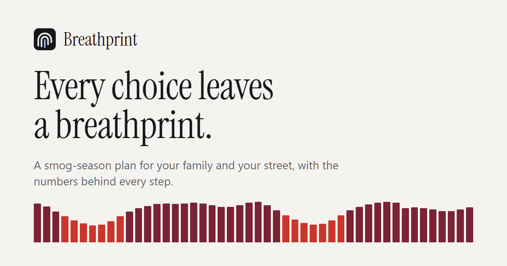

# Breathprint

Every choice leaves a breathprint.

Breathprint turns tomorrow's smog forecast into a plan for your family: when to air the house, which room to filter tonight, which trips to change and who needs a mask. Every step shows what it does for the air your family breathes, the air your street shares and your wallet, with the formula and the source one tap away.

Live at https://breathprint-zeta.vercel.app, or open https://breathprint-zeta.vercel.app/?demo=meera for Meera's family in Delhi on a severe winter morning. Built for PromptWars 6, in English and Hindi.



## How it meets the brief

| The brief asks for                         | Where it lives                                                                                                                                                                                |
| ------------------------------------------ | --------------------------------------------------------------------------------------------------------------------------------------------------------------------------------------------- |
| A GenAI-powered assistant                  | Three Gemini jobs in `server/ai/`: the day's personal plan, Ask, and community advisories                                                                                                     |
| Families and communities                   | A household by age and condition (`shared/profile.ts`); advisories for a housing society, school or workplace, with what many households together keep out of the air (`shared/community.ts`) |
| Severe winter smog and urban air pollution | CAMS forecasts, India NAQI and US AQI, NowCast, the day's clean window and peak (`shared/aqi.ts`, `shared/air.ts`)                                                                            |
| Low-emission daily routines                | Commute, school-run and errand swaps, timed against the forecast (`shared/actions/travel.ts`, `shared/plan.ts`)                                                                               |
| Indoor air quality hacks                   | Airing in the clean window, purifiers and box-fan filters, sealing gaps, cooking and incense, from an indoor mass-balance model (`shared/actions/home.ts`, `shared/exposure.ts`)              |
| Sustainable alternatives                   | Every step carries a Prevent ledger: PM2.5 and CO2 kept off the street, beside the Protect ledger for the family                                                                              |
| Tailored to location and lifestyle         | The forecast for your grid cell, your household, travel, home, budget and language                                                                                                            |
| Clearly explaining the direct impact       | An impact panel per step with a range, the formula and a cited source (`web/src/features/plan/ImpactPanel.tsx`, `shared/sources.ts`)                                                          |

## How it works

The model may choose and explain, but it never calculates. Every number on screen comes from `shared/`, a tested TypeScript engine that runs in the browser and on the server: AQI on the India and US scales, indoor and travel exposure, emissions, and each action's effect as a range with a cited source in `shared/sources.ts`. Because the engine runs on the device, a checked plan appears instantly and still works offline.

`server/` is a small Hono API that fetches CAMS forecasts and place search from Open-Meteo, caches them, and rounds every location to 0.1 degree. `web/` is the React app. Your household stays in your browser; there are no accounts and no database.

## Gemini

Gemini has three jobs, and each one sits behind an answer the engine already gave, so the app never waits on the model or goes blank without it. On Today, once you agree, it writes a plan for your household from the actions the engine ranked. The checker in `shared/plan.ts` holds it to the same safety rules as the rule plan: never seal the house while an angithi burns, air rooms only in a clean window, and cover every sensitive person. A plan that breaks a rule gets one chance to fix it, and otherwise the rule plan stays. On Ask, it streams an answer grounded in today's forecast, your household and cited knowledge cards, and every claim links to its source. It never judges the air itself: the engine decides when to open the windows, and whether a walk or play outside is fine now, should wait for a window it names, or belongs indoors today. The model passes that on, and on an indoor day the engine adds its own indoor step if the model leaves one out. On Community, it writes a WhatsApp message or a printed notice for a housing society, school or workplace.

The model only sees what it needs: your household without names, its place rounded to about 11 km, and figures the engine has already worked out. Any figure it writes that isn't in that data is caught, and the reply is either fixed or flagged on screen.

`just eval` scores the model on 35 cases across four households, on severe, clearing and clean days, in both languages, with a medical emergency and a prompt injection, and saves its replies. Each reply is checked for what matters to the person reading it: the right language and script, short sentences, every figure from the data, a cited source, the engine's call on going outside, the window's hours or the indoor alternative, an answer that stays on the question asked, and none of the prompt read back. The latest run scored 100% on all 35 cases with gemini-3.5-flash-lite. `just check` scores those saved replies again, so a change that lowers the score fails the build. To run the AI yourself, put a free key from [AI Studio](https://aistudio.google.com/apikey) in `.env` as `GEMINI_API_KEY`; without one, everything else still works.

## Security, accessibility and tests

The Gemini key lives only in the host's environment. Every route validates its input with zod under a body limit, checks the request's origin and is rate-limited per IP, more tightly on the model routes. The response headers in `server/headers.ts` set a strict Content-Security-Policy, HSTS and no framing. Model output is parsed against a schema, user text reaches the model fenced as data, and the evals include a prompt-injection case. CI audits the dependencies.

The app aims at WCAG 2.2 AA. CI runs axe on every page in light and dark themes and fails on any violation. Every AQI level carries a word and a number as well as a colour, the forecast chart has a table view, streamed answers are announced through a live region, the page's `lang` follows the chosen language, and the layout holds at 320 px with a skip link and full keyboard use.

`bun test` runs 220 unit, property and route tests against a fixture forecast and a scripted model, with no network. `just e2e` drives the demo path in a real browser. GitHub Actions runs both, plus lint, types, the build's JavaScript budget and the eval replay, on every push.

## Run it

```bash
bun install
bun run build
bun run start
```

Open http://localhost:8787 to set up your own household, or http://localhost:8787/?demo=meera for the demo. `just dev` runs the app with live reload, `just check` runs everything CI does, and `just e2e` runs the browser tests.

## What's next

A room scan, where a photo of the kitchen lets Gemini spot the incense, the missing chimney or the open window and the engine ranks the fixes by impact per rupee. After that, voice questions in Hindi, and a service worker so the last plan opens with no signal at all.

Air quality data: Copernicus Atmosphere Monitoring Service forecasts through [Open-Meteo](https://open-meteo.com/), CC BY 4.0.

## Licence

MIT. Engineered by Arjun Krishnan.
