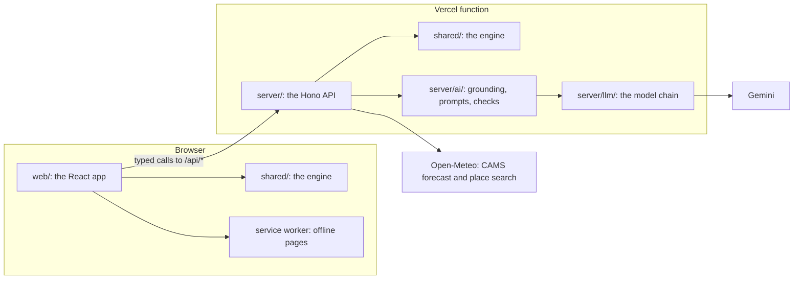

# Architecture

Breathprint has one rule, and the layout exists to keep it: every number a family sees comes from a tested engine, and the model only chooses and explains. Three parts share that engine.

## The three parts

**`shared/`, the engine.** Pure TypeScript with no I/O: AQI on both scales, the air summary and its clean windows, indoor and travel exposure, the action catalogue with every factor and its source, the planner and the plan checker, the knowledge cards and their search, and the strings in both languages. The browser runs it for the instant plan and every what-if; the server runs the same code to ground the model and to check what it writes. Lint holds the line: a file in `shared/` that imports React, Hono, the Gemini SDK, a Node built-in or anything from `server/` or `web/` fails the build.

**`server/`, the API.** One Hono app, built by `createApp(deps)` in `app.ts`, so the Vercel function, the Bun server and the tests all run the same code with different dependencies. Every API request passes the same middleware in order: a request id, the access log, the security headers, the origin check and the body limit, then a per-visitor rate limit, with a tighter one on the four model routes. Each route validates its input with zod and refuses with a typed error envelope.

**`web/`, the app.** One folder per page under `web/src/features/`, talking to the API through Hono's typed client, so a route's types reach the page without codegen. Every JSON reply is checked against the engine's schema before the page uses it (`replyOf` in `lib/api.ts`), and the chat stream is checked event by event. Pages that need the forecast sit inside `AirPage`, which handles setup, loading and a failed fetch in one place.

## A personal plan, start to finish

1. Today shows the engine's plan at once, from the forecast and the household already in the browser.
2. If the family has agreed, the page sends the household to `POST /api/plan`, without names and with its place rounded to the 11 km grid.
3. The server rebuilds the day itself (`contextFor` in `server/ai/grounding.ts`), never trusting figures from the client, and ranks the actions with their impacts.
4. `plannerRequest` turns that into a prompt: the air as windows and peaks, the household by role, and only the options the engine ranked.
5. The model chain asks Gemini for a `DayPlan` as JSON. A 429 or a timeout moves to the next model in `LLM_MODELS`, a server error gets one retry, and when no model answers the route says so and the engine's plan stays.
6. `readPlan` parses the reply against its schema, runs the checker the engine's own plan passes, and treats any figure that isn't in the data as an error. A reply with issues goes back once, with the issues attached, for a repair; a second failure is refused.
7. The page says a fitted plan is ready and swaps it in only when asked.

Chat, the room scan and the community advisories follow the same path: grounding from the engine, one model call, a schema, the figure guard, and the engine's own answer whenever anything fails.

## Ports

Everything that reaches the outside world sits behind a small type, so tests swap in a stand-in and never touch the network.

| Port                                           | In production                                     | In tests and the demo                                                                                    |
| ---------------------------------------------- | ------------------------------------------------- | -------------------------------------------------------------------------------------------------------- |
| `AirSource` in `server/air/source.ts`          | Open-Meteo, cached per grid cell for half an hour | `server/air/fixture.ts`, a fixed severe day in Delhi                                                     |
| `Geocoder` in `server/geocode.ts`              | Open-Meteo place search                           | a stub in `server/test/app.ts`                                                                           |
| `Llm` in `server/llm/llm.ts`                   | Gemini, or Ollama for local work                  | a scripted model in `server/llm/fake.ts`, and saved real answers for the demo in `server/ai/recorded.ts` |
| `ClientIp` in `server/middleware/rateLimit.ts` | `x-real-ip` on Vercel, the socket under Bun       | the same header, set by each test                                                                        |

## What the tooling enforces

- **Types.** TypeScript strict, with `noUncheckedIndexedAccess`, `exactOptionalPropertyTypes`, `noImplicitReturns` and erasable syntax only. A Hindi string missing for an English key is a type error.
- **Lint.** Biome with nothing waived: no function longer than 50 lines or above a cognitive complexity of 10, no `any`, no non-null assertions, no floating promises, nothing unused, and the engine's boundary above.
- **Dead code.** knip fails the check on any file, export or dependency that nothing uses.
- **Tests.** 95% of lines overall and 98% in `shared/`, and a source file that no test loads fails the gate, so an untested page can't hide.
- **Size.** The build fails if the JavaScript a first visit loads passes 120 KB gzipped.
- **The model.** The eval replay scores the saved replies again, so a change that lowers the score fails the build.

`just check` runs all of it, and CI runs the same steps on every push.

## Adding an action

1. Its factors go in `shared/factors.ts`, each with a source in `shared/sources.ts`.
2. Its definition, eligibility and impact go in `shared/actions/`, beside the others of its kind.
3. Its title, detail and reason go in `shared/i18n/en.ts` and `hi.ts`, with a placeholder for every figure.
4. A test in `shared/actions/catalogue.test.ts` shows when it applies and what it changes.

The planner, the checker, the grounding and the impact panel all read the catalogue, so nothing else changes.
